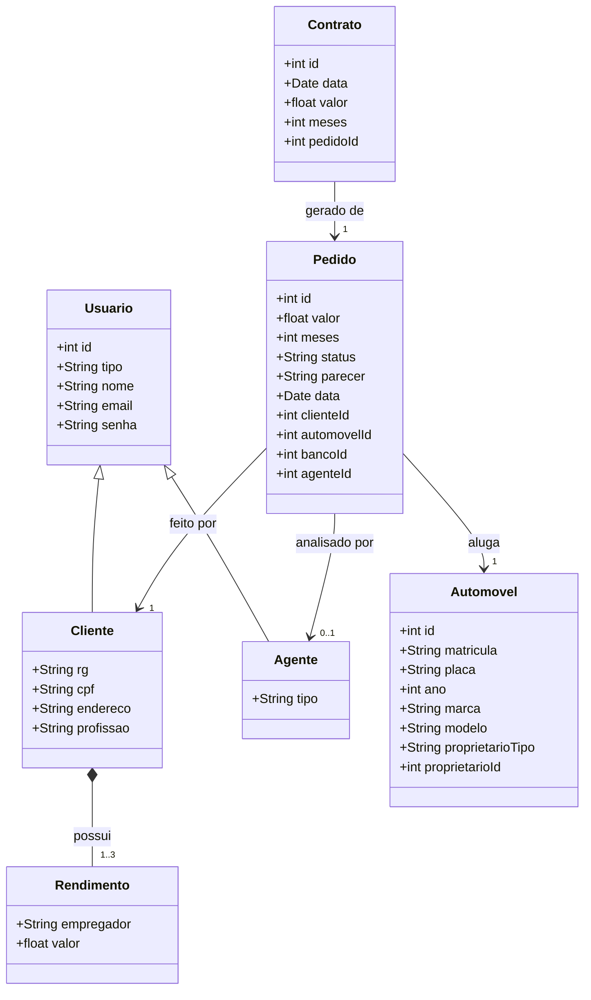
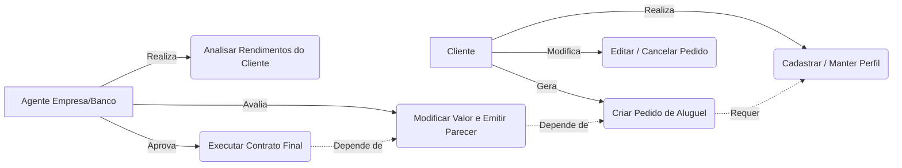
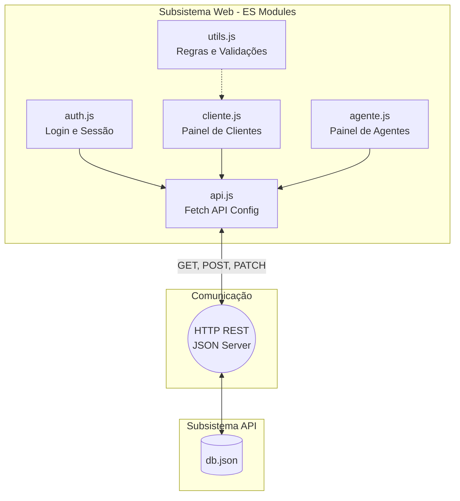

# AluguelCar - Sistema de Aluguel de Carros

> \[!NOTE\]
> Sistema Web para apoio à gestão de aluguéis de automóveis, permitindo que clientes e agentes gerenciem pedidos e contratos através da Internet. Desenvolvido como protótipo para o **Laboratório 02 - DIW (PUC Minas)**.

## 🚧 Status do Projeto

## 📚 Índice

- [Sobre o Projeto](#-sobre-o-projeto)
- [Histórias de Usuário](#-histórias-de-usuário)
- [Funcionalidades Principais](#-funcionalidades-principais)
- [Tecnologias Utilizadas](#-tecnologias-utilizadas)
- [Arquitetura e Modelagem UML](#-arquitetura-e-modelagem-uml)
  * [Diagrama de Classes](#1-diagrama-de-classes)
  * [Diagrama de Casos de Uso](#2-diagrama-de-casos-de-uso-fluxo)
  * [Arquitetura e Componentes](#3-diagrama-de-componentes-e-pacotes)
- [Instalação e Execução](#-instalação-e-execução)
- [Estrutura de Pastas](#-estrutura-de-pastas)
- [Autores](#-autores)

## 📝 Sobre o Projeto

O **AluguelCar** foi concebido para resolver o problema da burocracia na aprovação e gestão de aluguéis de veículos. O sistema conecta três entidades principais: **Clientes** (que desejam alugar), **Empresas** (agentes avaliadores) e **Bancos** (agentes concessores de crédito).

- **Por que ele existe:** Para digitalizar e agilizar o fluxo de análise de crédito e locação de frotas automotivas.
- **Qual o contexto:** Trabalho prático (Laboratório 02) do curso de Engenharia de Software da PUC Minas.
- **Onde pode ser utilizado:** Empresas de locação de veículos de médio a grande porte que dependem de análise de agentes externos para aprovação de crédito.

## 🧑‍💻 Histórias de Usuário

As seguintes *User Stories* guiaram o desenvolvimento do software:

| ID | Como um(a)... | Eu quero... | Para poder... | 
| ----- | ----- | ----- | ----- | 
| **US01** | Cliente | me cadastrar no sistema informando meus rendimentos (até 3) e dados pessoais | ter um perfil apto a solicitar o aluguel de automóveis. | 
| **US02** | Cliente | solicitar um novo pedido de aluguel associado a um automóvel e um banco | dar início ao processo de locação de um veículo. | 
| **US03** | Cliente | consultar, editar e cancelar meus pedidos que estão "Em análise" | gerenciar minhas solicitações antes da aprovação final. | 
| **US04** | Agente | visualizar todos os pedidos submetidos pelos clientes e seus dados financeiros | ter embasamento para aprovar ou reprovar o crédito. | 
| **US05** | Agente | emitir um parecer financeiro (Aprovado, Reprovado, Em Análise) e ajustar valores | decidir se o aluguel é viável financeiramente. | 
| **US06** | Agente | executar o contrato de locação de um pedido previamente aprovado | formalizar a locação no sistema. | 

## ✨ Funcionalidades Principais

- 🔐 **Gestão de Sessão (Auth):** Autenticação simulada no Front-end via `sessionStorage` e validação no db.json.
- 👤 **CRUD de Usuários:** Cadastro segmentado para Clientes (com rendimentos, CPF validado, etc) e Agentes (Bancos/Empresas).
- 🚗 **Gestão de Automóveis:** Vinculação dinâmica de propriedades de automóveis aos agentes e clientes.
- 📄 **Fluxo de Pedidos:** Controle de estado do pedido (*Em análise, Aprovado, Reprovado, Contratado, Cancelado*).
- 💰 **Análise de Crédito:** Interface exclusiva para agentes verificarem dados sensíveis do cliente (rendimentos) e deferirem propostas.

## 🛠 Tecnologias Utilizadas

### 💻 Front-end

- **Linguagem:** HTML5, CSS3, JavaScript (ES6+ Modules)
- **Estilização e UI:** Bootstrap 5 (via CDN)
- **Integração:** Fetch API (Assíncrono via `async/await`)

### 🖥️ Back-end (Mock)

- **API e Persistência:** [JSON Server](https://github.com/typicode/json-server) (Cria uma API RESTful completa a partir de um arquivo `db.json`)
- **Protocolo:** HTTP (GET, POST, PUT, PATCH, DELETE)

## 🏗 Arquitetura e Modelagem UML

O sistema foi arquitetado em dois subsistemas (Visão Lógica): a construção dinâmica da UI no navegador (Front-end) e a gestão e persistência dos pedidos (Back-end JSON).

### 1. Diagrama de Classes

Abaixo a representação das Entidades de Domínio e seus relacionamentos:



### 2. Diagrama de Casos de Uso (Fluxo)

Representação dos papéis dos Atores na aplicação:



### 3. Diagrama de Componentes e Pacotes

Como o sistema está organizado do ponto de vista de diretórios (Separação de Responsabilidades) e comunicação de rede:



## 🔧 Instalação e Execução

Para rodar este projeto, você precisa iniciar tanto a **API (JSON Server)** quanto os **arquivos HTML**.

### Pré-requisitos

- **Node.js** (para instalar o JSON Server)
- Um servidor web local para os arquivos HTML (Ex: extensão **Live Server** no VSCode). *Nota: Devido ao uso de `type="module"`, não é possível abrir os arquivos HTML dando um "duplo clique" direto no navegador.*

### 1. Iniciar o Banco de Dados / API (Terminal 1)

Na raiz do projeto, instale o JSON Server (se ainda não tiver):

```bash
npm install
```

Inicie a aplicação:

```bash
npm start
```

*A aplicação estará rodando em `http://localhost:3000`*

### 2. Iniciar o Front-end (Terminal 2 ou VSCode)

Com o VSCode aberto na pasta do projeto, clique no botão **"Go Live"** no canto inferior direito (Extensão Live Server).
*A aplicação abrirá no navegador, geralmente em `http://127.0.0.1:5500/index.html`*

## 📂 Estrutura de Pastas

Organização dos arquivos baseada na refatoração modular recomendada.

```text
.
├── css/
│   └── style.css            # Estilizações customizadas além do Bootstrap
├── js/
│   ├── agente.js            # Lógica exclusiva das Views do Agente
│   ├── api.js               # Wrapper da Fetch API
│   ├── auth.js              # Inicialização, Login e Cadastro
│   ├── cliente.js           # Lógica exclusiva das Views do Cliente
│   ├── perfil.js            # Regras e modais de Perfil de Usuário
│   └── utils.js             # Funções utilitárias (mascaras, DOM, modais)
├── agente.html              # Página de painel do Agente
├── cliente.html             # Página de painel do Cliente
├── index.html               # Página de entrada / Login
├── db.json                  # Banco de Dados Mock do JSON Server
└── README.md                # Documentação
```

## 👥 Autores

| 👤 Nome | 🎓 Papel | 🏢 Instituição | 
| ----- | ----- | ----- | 
| **Gabriela Schaper** | Desenvolvedor Full-Stack (Aluno) | PUC Minas - Engenharia de Software | 
| **João Paulo C. Aramuni** | Professor (Orientação Acadêmica) | PUC Minas | 

## 📄 Licença

Este projeto foi desenvolvido para fins estritamente acadêmicos (Laboratório 02 de DIW - PUC Minas).
Baseado no modelo distribuído sob a Licença MIT.
